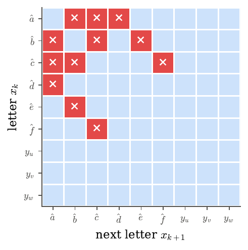
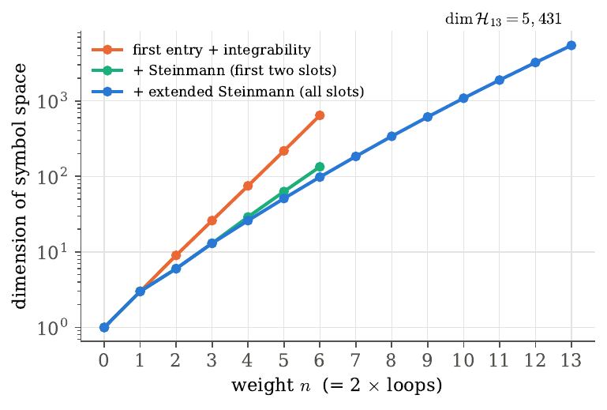
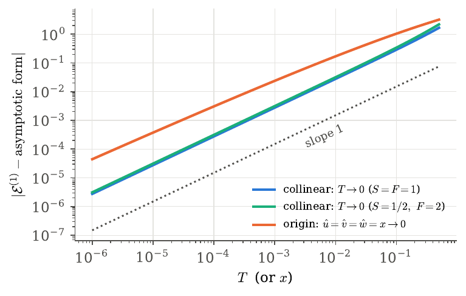
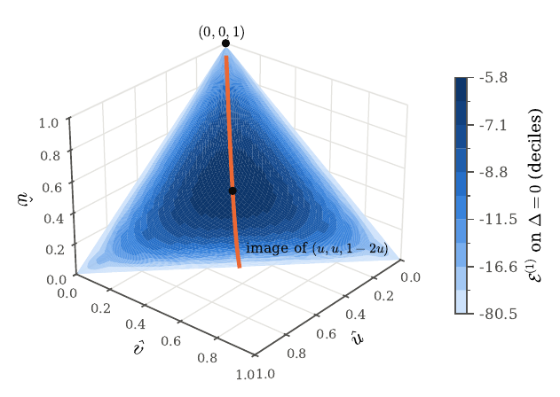
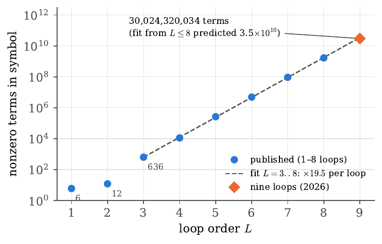
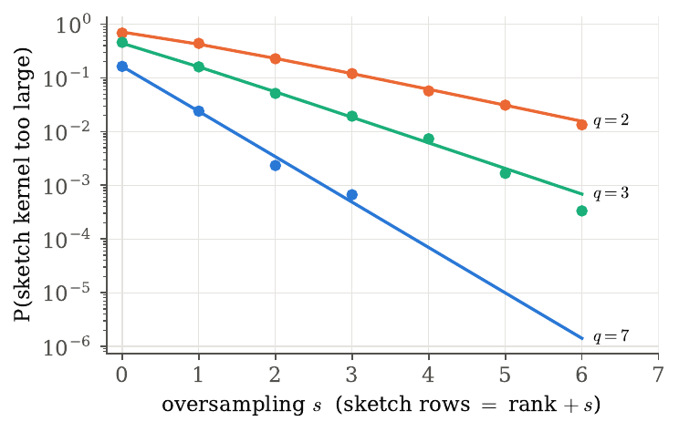
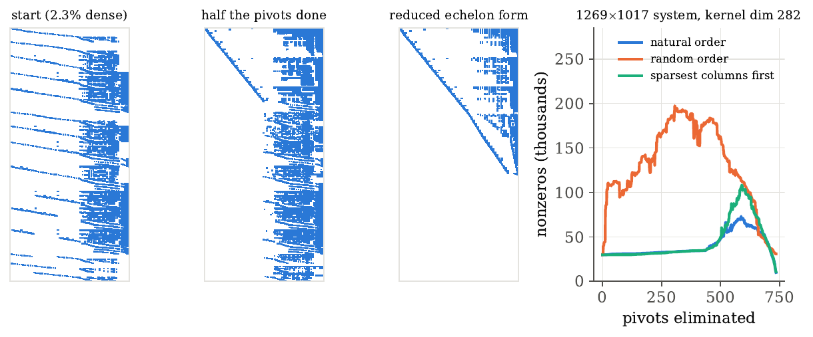
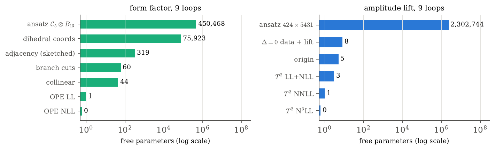

# Nine Loops

**The mathematics behind the AI-assisted nine-loop six-gluon amplitude in planar 𝒩 = 4 super-Yang–Mills, with a small working reproduction of the method.**

In September 2026 two independent computations produced the nine-loop symbol of the six-gluon MHV amplitude in planar 𝒩 = 4 super-Yang–Mills: one by Claude (Anthropic), validated by Lance Dixon, and one by Song He, Jirong Jing and Xiang Li. This repository explains the mathematics that makes such a computation possible and contains about 1,100 lines of Python and C that rebuild the method from scratch at lower loop orders. The code reproduces published results along the way, and every number below marked *ours* comes from it.

The short version: a hard problem in theoretical physics reduces to **exact linear algebra on tensor-structured spaces**. Iterated kernels, symmetry reduction, randomized sketching with one-sided error, arithmetic over finite fields, and rational reconstruction do most of the work.

---

## Contents

1. [The problem](#1-the-problem)
2. [The mathematics: symbols and the hexagon bootstrap](#2-the-mathematics-symbols-and-the-hexagon-bootstrap)
3. [Worked example: bootstrapping one, two and three loops](#3-worked-example-bootstrapping-one-two-and-three-loops)
4. [Antipodal duality: amplitudes and form factors](#4-antipodal-duality-amplitudes-and-form-factors)
5. [Nine loops as numerical linear algebra](#5-nine-loops-as-numerical-linear-algebra)
6. [What the AI did](#6-what-the-ai-did)
7. [Running the code](#7-running-the-code)
8. [References](#8-references)

---

## 1. The problem

A scattering amplitude $\mathcal A$ is a complex function of particle momenta; $|\mathcal A|^2$ gives the probability of a process. At weak coupling it is a power series $\mathcal A=\mathcal A^{(0)}+g^2\mathcal A^{(1)}+g^4\mathcal A^{(2)}+\cdots$, and the $L$-th term is the *$L$-loop* contribution: one extra integral over an unobserved momentum per loop. Most collider predictions use two loops, a few three.

Planar 𝒩 = 4 super-Yang–Mills (the limit of many colours with $g^2=g_{\rm YM}^2N_c/16\pi^2$ fixed) has the same gluons as QCD but far more symmetry, which makes it the standard proving ground for new methods. Its six-gluon MHV amplitude factorizes as

$$
\mathcal A_6^{\rm MHV}=\mathcal A_6^{\text{BDS-like}}\;\rho(g^2)\;\mathcal E(\hat u,\hat v,\hat w;g^2),\qquad
\mathcal E=1+\sum_{L\ge1}g^{2L}\,\mathcal E^{(L)} ,
$$

where $\mathcal A_6^{\text{BDS-like}}$ is known to all orders and $\mathcal E^{(L)}$ is a multiple polylogarithm of **weight $2L$** in three dual-conformal cross-ratios

$$
\hat u=\frac{s_{12}s_{45}}{s_{123}s_{345}},\quad \hat v=\frac{s_{23}s_{56}}{s_{234}s_{123}},\quad \hat w=\frac{s_{34}s_{61}}{s_{345}s_{234}},\qquad
\Delta=(1-\hat u-\hat v-\hat w)^2-4\hat u\hat v\hat w .
$$

The goal was $\mathcal E^{(9)}$, a weight-18 function. The loop order has advanced roughly one step at a time, each needing a new idea that shrinks the search space:

| loops (weight) | new ingredient | reference |
|---|---|---|
| 2 (4) | the symbol (17 pages → a few lines) | arXiv:1006.5703 |
| 3 (6) | first bootstrap, at symbol level | arXiv:1108.4461 |
| 4 (8) | multi-Regge and near-collinear (OPE) data | arXiv:1402.3300 |
| 5 (10) | Steinmann relations | arXiv:1609.00669 |
| 6, 7 (12, 14) | *extended* Steinmann, coaction principle | arXiv:1903.10890 |
| 8 (16) | via a form factor and antipodal duality | arXiv:2308.08199 |
| **9 (18)** | **same recipe, one loop higher** (Claude; independently He–Jing–Li) | 2026 |

---

## 2. The mathematics: symbols and the hexagon bootstrap

### Polylogarithms and the symbol

A weight-$n$ multiple polylogarithm $F$ is defined by its differential, $dF=\sum_x F^{x}\,d\ln x$, with $F^x$ of weight $n-1$ and $x$ ranging over a finite **alphabet** of letters. Iterating gives the **symbol**

$$
\mathcal S(F)=\sum_x \mathcal S(F^x)\otimes x,\qquad \mathcal S(\ln x)=x,\qquad
\mathcal S\big(\mathrm{Li}_2(x)\big)=-(1-x)\otimes x .
$$

The last entry records derivatives and the first entry records branch cuts. Products become shuffles, and letters are multiplicative. Up to boundary constants, a polylog *is* a tensor in $V^{\otimes n}$, $V=\mathbb Q^{|\text{alphabet}|}$. At one loop, $\mathcal E^{(1)}=\sum_i\mathrm{Li}_2(1-1/\hat u_i)$ and

$$
\mathcal S\big(\mathcal E^{(1)}\big)=-\tfrac12\big(\hat a\otimes\hat e+\hat a\otimes\hat f+\hat b\otimes\hat d+\hat b\otimes\hat f+\hat c\otimes\hat d+\hat c\otimes\hat e\big).
$$

### The nine-letter hexagon alphabet

$$
\hat a=\frac{\hat u}{\hat v\hat w},\ \hat b=\frac{\hat v}{\hat w\hat u},\ \hat c=\frac{\hat w}{\hat u\hat v},\qquad
\hat d=\frac{1-\hat u}{\hat u},\ \hat e=\frac{1-\hat v}{\hat v},\ \hat f=\frac{1-\hat w}{\hat w},\qquad y_u,\,y_v,\,y_w ,
$$

where the $y$'s carry $\sqrt\Delta$. In the variables $y$ everything is rational, e.g. $\hat u=y_u(1-y_v)(1-y_w)/\big((1-y_uy_v)(1-y_uy_w)\big)$. Parity sends $y_i\to1/y_i$; on the surface $\Delta=0$ all $y_i=1$.

### Integrability and physics are linear constraints

Not every tensor is a symbol. Integrability ($d^2=0$) requires, for every pair of adjacent slots,
$\sum c_{\cdots\alpha\beta\cdots}\,d\ln x_\alpha\wedge d\ln x_\beta=0$. Evaluating these 2-forms at random rational points gives the constraint space. **Ours:** rank 26, i.e. 55 integrable pairs out of 81.

The physics adds more linear, local constraints:

- **First entry** (branch cuts only where an invariant vanishes): first letter $\in\{\hat a,\hat b,\hat c\}$.
- **Extended Steinmann** (causality): $\hat a\otimes\hat b$, $\hat b\otimes\hat c$, $\hat c\otimes\hat a$ never adjacent, in any slot.
- **MHV final entry** (supersymmetry, $\bar Q$ equation): $\mathcal E^{\hat a}=\mathcal E^{\hat b}=\mathcal E^{\hat c}=0$.
- **Symmetry:** parity even; invariant under the dihedral group $D_3$.

Imposing only integrability and those three Steinmann pairs, **twelve forbidden adjacencies emerge** (six of them, $\hat a\hat d,\hat d\hat a,\hat b\hat e,\hat e\hat b,\hat c\hat f,\hat f\hat c$, never imposed), and the space of allowed adjacent pairs is **40-dimensional**. Both facts match the literature.

<p align="center"></p>

### The function spaces are iterated kernels

Store a basis of the space $\mathcal H_n$ of allowed weight-$n$ symbols as *nested coproduct tensors*
$F^{(n)}_i=\sum_{j,\alpha}T_n[\alpha]_{ij}\,F^{(n-1)}_j\otimes x_\alpha$. The ansatz $F=\sum c_{j\beta}F^{(n-1)}_j\otimes x_\beta$ must satisfy each pair relation $D_m$ on its last two slots:

$$
\sum_{\alpha,\beta}D_{m\alpha\beta}\,T_{n-1}[\alpha]_{jk}\,c_{j\beta}=0\quad\forall k,m
\qquad\Longrightarrow\qquad \mathcal H_n=\ker M_n .
$$

A word's coefficient is a product of $n$ matrices, $c(x_1\cdots x_n)=e_i^{\top}T_n[x_n]\cdots T_1[x_1]\mathbf 1$. This is the same representation the nine-loop data use. All arithmetic is exact modulo $p=2^{31}-1$, with a zero-skipping C elimination kernel.

**Ours** (`hexspace.py`), matching Table 1 of arXiv:1906.07116 and the nine-loop data page:

| weight $n$ | 6 | 8 | 10 | 11 | 12 | 13 |
|---|---|---|---|---|---|---|
| $\dim\mathcal H_n$ | 98 | 340 | 1,085 | 1,887 | 3,224 | **5,431** |
| even + odd | 85+13 | 282+58 | 875+210 | 1505+382 | 2553+671 | 4269+1162 |

Weight 13, the space the nine-loop computation lives in, takes about 17 minutes on one laptop core.

<p align="center"></p>

---

## 3. Worked example: bootstrapping one, two and three loops

The bootstrap is a Sudoku. Start from every function in $\mathcal H_{2L}$, then cross out what physics forbids. Boundary data finish the job:

- **Collinear limit** ($T\to0$): letters tend to monomials in $T,S,1+S^2,F$, and $\mathcal S[\mathcal E^{(L)}]\to\mathcal S[(\mathcal E^{(1)})^L/L!]$ with $\mathcal E^{(1)}\to-2\ln^2T-2\ln^2S$.
- **Origin** ($\hat u,\hat v,\hat w\to0$; Basso–Dixon–Papathanasiou): the same exponentiation, with $\mathcal E^{(1)}\to-\tfrac12\sum\ln^2\hat u_i$.

Both asymptotic forms check out numerically at function level, including the $\zeta_2$ constants:

<p align="center"></p>

Limits are imposed with **random rank-one tests**. Rather than forming the $k^n$-entry limit tensor, both sides are contracted with $z_1\otimes\cdots\otimes z_n$, $z_i\in\mathbb F_p^k$. The amplitude side costs $n$ matrix–vector products. The target (a polynomial in logs) is evaluated by polarization, $\sum_{S\subseteq[n]}(-1)^{n-|S|}P(\sum_{i\in S}z_i)$. A sampled system can only have a kernel that is too large, never too small.

**Ours** (`bootstrap2.py`), parameters left after each constraint:

| constraint | L=1 | L=2 | L=3 | L=4 | L=5 | L=6 |
|---|---|---|---|---|---|---|
| $\mathcal H_{2L}$ | 6 | 26 | 98 | 340 | 1085 | 3224 |
| MHV final entry | 3 | 11 | 41 | 142 | 446 | 1292 |
| parity even | 3 | 9 | 31 | 102 | 311 | 885 |
| dihedral $D_3$ | 1 | 3 | 9 | 25 | 71 | 197 |
| collinear limit | 0 | 0 | 1 | 2 | 6 | 14 |
| origin | 0 | 0 | **0** | 1 | 4 | 11 |
| form-factor collinear limit (via duality) | 0 | 0 | 0 | 1 | 4 | 11 |
| Euclidean multi-Regge limit | 0 | 0 | 0 | 1 | 4 | 11 |

The answer is **unique through three loops** using only symmetry and two cheap limits. From four loops on, these limits are blind to some directions. Historically, those directions were fixed with multi-Regge (BFKL) and near-collinear flux-tube (OPE) data; at nine loops the last five directions were visible only at order $T^2$ of the OPE. We also checked that the multi-Regge super-leading-log identity holds automatically at $L=2,3$ and gives no new equations at $L=4$.

---

## 4. Antipodal duality: amplitudes and form factors

The **form factor** $F_3(u,v,w)$, $u+v+w=1$, is three gluons produced by a local operator (the 𝒩 = 4 cousin of $H\to ggg$), with a six-letter alphabet. Dixon, Gürdoğan, McLeod and Wilhelm found

$$
F_3^{(L)}(u,v,w)=S\big(\mathcal E^{(L)}\big)\Big|_{\hat u=\frac{vw}{(1-v)(1-w)},\ \hat v=\frac{uw}{(1-u)(1-w)},\ \hat w=\frac{uv}{(1-u)(1-v)}},
$$

where the antipode reverses every word, $S(x_1\otimes\cdots\otimes x_m)=(-1)^m x_m\otimes\cdots\otimes x_1$. The form-factor kinematics land on the surface $\Delta=0$, and letters swap ($\sqrt{\hat a}\leftrightarrow d$, $\hat d\leftrightarrow a$). Discontinuities of one object become derivatives of the other. The duality has been verified through eight loops; no physical explanation is known.

<p align="center"></p>

A rotating version is in `figs/anim/` (36 frames).

**Checks against the literature (ours, `checks.py`):**

- $\mathcal S(\mathcal E^{(2)}|_{\Delta=0})=\tfrac12\,\hat a\hat a\hat a\hat e+\hat a\hat e\hat e\hat e+\text{dihedral}$ (PRL eq. 22). ✓
- Its antipode is $2\,aaae+4\,aeee+\text{dihedral}$, the published two-loop form factor (PRL eq. 23). ✓
- Term counts of $F_3^{(L)}$ obtained through the duality: **6, 12, 636** at $L=1,2,3$, matching Table II of arXiv:2112.06243. ✓
- At four loops, any generic value of the one free direction gives exactly the published **11,208** terms (25 special values give fewer). The free direction touches 9,792 words on $\Delta=0$, so form-factor data there fix it. That is why the duality is useful.

**Why the nine-loop lift has 222 unknowns (ours, `lift.py`).** Which functions in $\mathcal H_n$ vanish on $\Delta=0$, and so are invisible to the form factor? Recursively, $c\in\ker R_n\iff cT_n[\alpha]\in\ker R_{n-1}$ for the six non-$y$ letters.

| weight $n$ | 2–11 | 12 | 13 |
|---|---|---|---|
| odd functions vanishing on $\Delta=0$ | all odd | 671 | 1,162 |
| **even** functions vanishing on $\Delta=0$ | 0 | **1** | **2** |

So through five loops the form factor determines the amplitude. The weight-12 even function obeys the MHV final entry and $D_3$, is invisible to the collinear limit, and is seen by the origin (`zfunc.py`): this is exactly the one-parameter six-loop ambiguity of arXiv:2308.08199. At weight 13, the two even functions attached to each of 111 $y$-free quintuple tails give $2\times111=222$ parameters, layer 0 of the nine-loop lift.

---

## 5. Nine loops as numerical linear algebra

<p align="center"></p>

The symbol on $\Delta=0$ grows by about ×19 per loop: **30,024,320,034 terms** at nine loops. A fit through $L\le8$ predicts $3.5\times10^{10}$. The *size* extrapolates; the *content* does not. Everything below is quoted from the nine-loop method notes.

**Pipeline.** (1) Bootstrap the form factor with ansatz $\mathcal C_5\otimes B_{13}$: $108\times4171=450{,}468$ unknowns, 75,923 after dihedral symmetry. (2) Apply the antipode to get $\mathcal E^{(9)}$ on $\Delta=0$. (3) Lift off the surface: $424\times5431=2{,}302{,}744$ unknowns. (4) Fix the remaining directions with origin and order-$T^2$ flux-tube data. An independent direct bootstrap that does not use the duality agrees on all **107,053** determining coefficients.

**Exact arithmetic over $\mathbb F_p$.** Ranks must be exact, and $\mathrm{rank}_{\mathbb F_p}\le\mathrm{rank}_{\mathbb Q}$, so a kernel computed mod $p$ can only be too large. The pipeline runs at $p_1=2^{31}-1$, $p_2=2147483629$ (and $p_3=2147483587$ for the form factor) and demands identical results. One bug was caught this way: a factor $4^{-L}$ applied as a floating-point product happened to be exact only for $p_1$.

**Back to $\mathbb Q$.** CRT plus rational reconstruction (Wang). Certification requires $|n|,d<2^{30}$ and $d$ a power of two, with false-positive rate about $2^{-26}$. The data page's example word has residues 829,521,918 and 1,173,913,588, giving **−105757/65536** (we re-derived this: nine Euclid steps). One prime alone is not enough. 1,014,476 of 1,018,297 coordinates (99.62%) are certified from two primes.

**Sketch-and-verify.** The constraints are sampled with 91,171 random rank-one functionals; one dense 91,171 × 75,923 modular elimination gives a 319-dimensional candidate kernel, which is then checked exactly against every constraint family (0 violations).

<p align="center"></p>

**Memory is the constraint.** Placing the seam at $\mathcal C_{10}\otimes B_8$ ($1{,}856{,}466$ unknowns, coproduct tables about 10% dense) would need about $10^{11}$ nonzeros. The fix was a deep back space whose dimensions were *predicted* from $\mathcal H_w$ via the duality (491, 857, 1472, 2495, 4171 at weights 9–13). Our own fill-in experiment on one real step (weight 8, even; a 1269 × 1017 system) shows how much ordering matters: same kernel, but peak nonzeros 73k (natural order), 108k (sparsest columns first), 197k (random).

<p align="center"></p>

**Symmetry in $\mathbb F_p$.** Block-diagonalizing under $D_3$ needs cube roots of unity, so $p\equiv1\pmod 3$, which holds for all three primes. The lift is then a five-layer block solve (peak memory about 50 GB; about 100 GB for the form-factor seam), leaving 8 directions → origin → 5 → $T^2$ data → 3 → 1 → 0.

<p align="center"></p>

---

## 6. What the AI did

Per the Anthropic write-up, the physicists used Claude (Fable 5.1, in the Claude Science harness). They first asked which challenge problem it was most likely to solve, then gave a one-sentence task: *"The problem is to compute the Six-particle (hexagon) amplitude in planar N=4 SYM at nine loops."* Later input was mostly "keep working". Each route cost roughly \$1–2k, mostly model usage; the bootstrap compute itself was about \$100 (96 CPUs for a week, Python with SymPy).

**It did not extrapolate the answer.** It carried out the published recipe of the 2019 and 2023 papers one loop higher, by two independent routes. What made it fit was engineering: the deep-back ansatz, sketch-and-verify, symmetry in $\mathbb F_p$, multi-prime reconstruction, and the layered lift. Genuine extrapolation in coefficient space is a different line of work (transformers predicting symbol coefficients, arXiv:2405.06107), which Dixon's team had been preparing.

**Validation:** two independent routes agree; the same programs reproduce the eight-loop amplitude (1,000 of 1,000 random words); held-out OPE data are satisfied (0 of 135 form-factor equations violated); He–Jing–Li computed the symbol independently; Dixon validated it via the form factor. **Stated limitations:** symbol level only (the function was computed once); 3,821 coordinates uncertified at two primes; the last five directions rest on flux-tube data alone.

---

## 7. Running the code

Requirements: Python 3 with `numpy`, `sympy`, `scipy`, `matplotlib`; a C compiler.

```bash
cd code
gcc -O3 -shared -fPIC -o librref.so rref.c   # finite-field elimination kernel
python3 demo.py                             # ~2 s: relations, dims of H_n, unique E1-E3, literature checks
./run_all_checks.sh                         # ~5 min: every number above marked "ours"
```

Longer runs: `python3 hexspace.py ext 13` (dim 5431, ~17 min), `python3 lift.py 13` (~25 min), `python3 cascade6.py` (~5 min). Saved outputs are in `results/`.

| file | what it does |
|---|---|
| `alphabet.py` | the nine letters in $y$ variables; 26 integrability + 3 Steinmann pair relations |
| `hexspace.py` | builds $\mathcal H_n$ as iterated kernels mod $2^{31}-1$ |
| `rref.c` | zero-skipping modular row reduction (int64 and uint32 storage) |
| `bootstrap.py` | bootstrap with exact limit tensors; exact modular matmul via float64 BLAS limbs; word counting by meet-in-the-middle |
| `bootstrap2.py` | bootstrap with random rank-one sketches (collinear, origin, form-factor collinear, Euclidean multi-Regge) |
| `checks.py` | comparisons with arXiv:2112.06243 |
| `demo.py`, `run_all_checks.sh` | quick demo; full reproduction with expected values in comments |
| `mrk_sll.py` | multi-Regge super-leading-log identity |
| `fix_by_count.py`, `dfe.py` | four-loop explorations (term count, final-entry spans) |
| `lift.py`, `zfunc.py` | functions vanishing on $\Delta=0$; the weight-12 function |
| `cascade6.py` | cascades through six loops |
| `figs.py`, `fig_*.py` | all figures in `figs/` |

---

## 8. References

- M. von Hippel (guest post) with addendum by L. Dixon, [*Yes, Claude can do nine loops*](https://www.anthropic.com/research/yes-claude-can-do-nine-loops), Anthropic (2026).
- [*Cosmically normalized six-point amplitudes at nine loops*](https://smsharma.io/cosmic-nine-loops/): data page, method notes and conventions.
- S. He, J. Jing, X. Li, *The symbols of six-gluon MHV amplitudes through nine loops*, Zenodo 10.5281/zenodo.22800071.
- L. Dixon, Y.-T. Liu, *An eight loop amplitude via antipodal duality*, [arXiv:2308.08199](https://arxiv.org/abs/2308.08199).
- L. Dixon, Ö. Gürdoğan, A. McLeod, M. Wilhelm, *Folding amplitudes into form factors: an antipodal duality*, [arXiv:2112.06243](https://arxiv.org/abs/2112.06243); *Bootstrapping a stress-tensor form factor through eight loops*, [arXiv:2204.11901](https://arxiv.org/abs/2204.11901).
- S. Caron-Huot, L. Dixon, F. Dulat, M. von Hippel, A. McLeod, G. Papathanasiou, [arXiv:1903.10890](https://arxiv.org/abs/1903.10890) and [arXiv:1906.07116](https://arxiv.org/abs/1906.07116).
- S. Caron-Huot, L. Dixon, A. McLeod, M. von Hippel, [arXiv:1609.00669](https://arxiv.org/abs/1609.00669).
- L. Dixon, J. Drummond, J. Henn, [arXiv:1108.4461](https://arxiv.org/abs/1108.4461); L. Dixon, J. Drummond, C. Duhr, J. Pennington, [arXiv:1402.3300](https://arxiv.org/abs/1402.3300).
- B. Basso, L. Dixon, G. Papathanasiou, *The origin of the six-gluon amplitude*, [arXiv:2001.05460](https://arxiv.org/abs/2001.05460).
- A. Goncharov, M. Spradlin, C. Vergu, A. Volovich, [arXiv:1006.5703](https://arxiv.org/abs/1006.5703).
- S. Caron-Huot, S. He, [arXiv:1112.1060](https://arxiv.org/abs/1112.1060).
- T. Cai et al., *Transforming the bootstrap*, [arXiv:2405.06107](https://arxiv.org/abs/2405.06107).
- P. S. Wang, *A p-adic algorithm for univariate partial fractions*, SYMSAC '81 (rational reconstruction).
